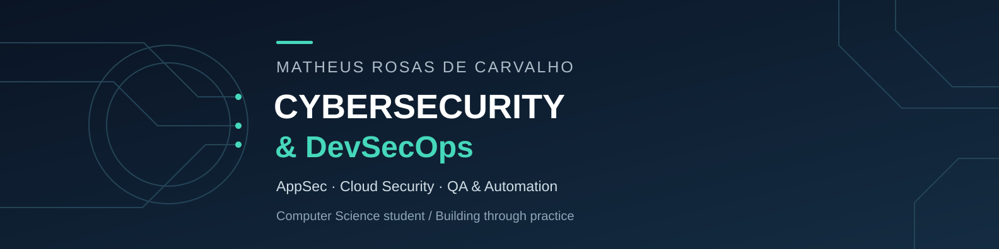

# Hi, I'm Matheus Rosas

**Computer Science student building a career in Cybersecurity and DevSecOps.**

I’m based in Rio de Janeiro, Brazil, and I’m interested in how development, security and operations work together. My direction is **Application Security, Cloud Security, quality and automation**.

I bring previous experience in data analysis, technical support, computer maintenance and business operations. Today, I’m connecting that practical background with formal study and personal software projects.

[Connect on LinkedIn](https://www.linkedin.com/in/matheus-rosas-de-carvalho-924378432/)

## Education & continuous learning

| Study | Institution / platform | Status |
| --- | --- | --- |
| BSc in Computer Science | Universidade Veiga de Almeida (UVA) | In progress |
| Software Engineering + Artificial Intelligence | EBAC | In progress |
| Practical cybersecurity | TryHackMe | Complementary studies |
| Online courses | Coursera | Complementary studies |
| English | Ongoing language studies | In progress |

## What I'm working toward

- **DevSecOps:** understanding how to integrate security and quality into the software lifecycle.
- **AppSec:** authentication, authorization, input validation and secure application design.
- **Cloud Security:** developing the foundations for secure infrastructure and operations.
- **QA & automation:** repeatable checks, documented behavior and reliable workflows.

These are my learning and career goals. I’m building experience through study and hands-on projects.

## Projects in progress

### Battlestar

A browser-based space strategy game built with **JavaScript, Node.js and SQLite**. The local version includes persistent accounts, progression, exploration, fleets and interactions between accounts.

**Learning connection:** server-side validation, authentication, access control, automated testing and backup/recovery.

[Read the project overview →](battlestar.md)

### TheFinance

A local personal finance application built with **JavaScript, Node.js and SQLite**, with transactions, accounts, cards, budgets, goals and reports.

**Learning connection:** data isolation between users, session management, input validation, transactional integrity and backup/restore flows.

[Read the project overview →](thefinance.md)

Both projects are under active development and currently run locally. The descriptions reflect implemented local features, not public production deployments.

## Background & direction

I worked as a **Data Analyst at Gax E-sports**, combining spreadsheets, operational organization and problem solving. My earlier background also includes technical support, device maintenance and business management.

I’m interested in entry-level technology opportunities where I can contribute, strengthen my foundations and grow toward Cybersecurity and DevSecOps.

---

<strong>Em português</strong>

Sou Matheus Rosas de Carvalho, estudante de Ciência da Computação na Universidade Veiga de Almeida, com formação complementar em Engenharia de Software + IA pela EBAC.

Meu objetivo de carreira é atuar com **Cibersegurança e DevSecOps**, conectando desenvolvimento, segurança, qualidade e automação. Tenho interesse especial em **AppSec e Cloud Security** e complemento minha formação com estudos no TryHackMe, Coursera e inglês.

Minha experiência anterior inclui análise de dados na Gax E-sports, suporte técnico, manutenção de equipamentos e gestão de operações. Desenvolvo o **Battlestar** e o **TheFinance** como projetos pessoais em andamento, usando a prática para aprofundar fundamentos técnicos e de segurança.

